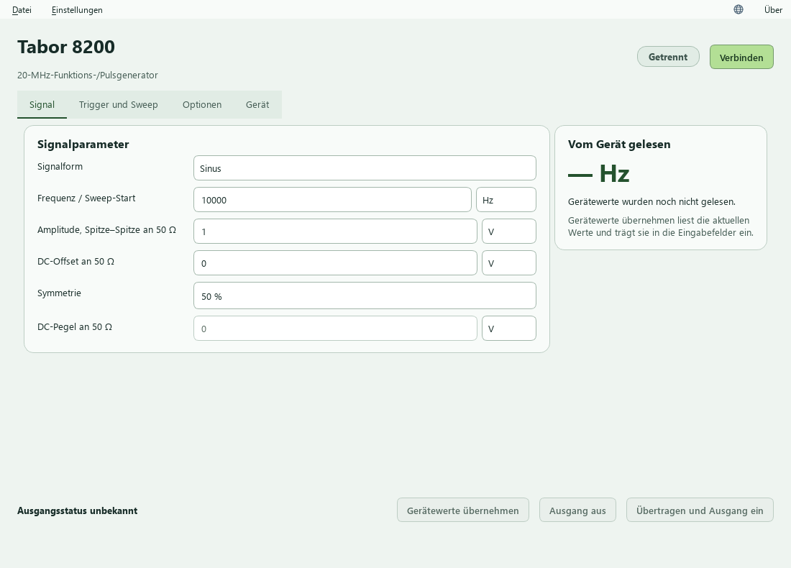
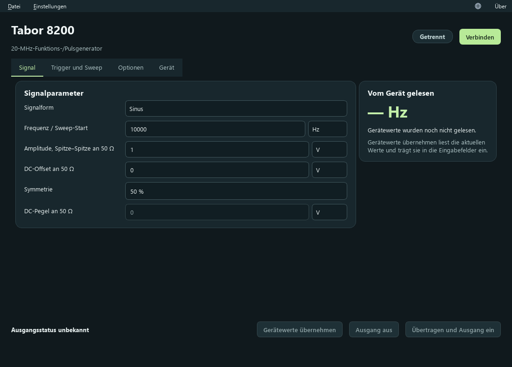

# Tabor 8200 Control

Windows-Anwendung für den programmierbaren Tabor-8200-Funktions-/Pulsgenerator und die Varianten 8220 und 8222. Bedienung und Geräteprotokoll folgen dem im Projektordner liegenden „Tabor 8200 20MHz Modulated FunctionPulse Generator, schematic Operator Manual.pdf“, besonders Kapitel 3 und 4.

## Bildschirmaufnahmen

| Hell | Dunkel |
| --- | --- |
| <a href="docs/screenshots/tabor8200-hell.png"></a> | <a href="docs/screenshots/tabor8200-dunkel.png"></a> |

## Installation unter Windows

Die Setups für x86 und x64 stehen im [aktuellen GitHub-Release](https://github.com/GitterRalf/tabor8200-control/releases/latest) bereit. Für den Download ist ein GitHub-Konto mit Zugriff auf das private Repository erforderlich. Das x64-Setup installiert standardmäßig nach `C:\Programme\Tabor 8200 Control` und enthalten die benötigten Qt- und MinGW-Laufzeitdateien. Den NI-488.2-Treiber mit Unterstützung für die Programmarchitektur für die GPIB-Verbindung separat installieren.

## Start und Verbindung

Tabor 8200 Control über das Startmenü oder bei einem lokalen Build über `build\Tabor8200-Control.exe` starten. Unter Einstellungen → Verbindung sind NI-488.2, GPIB-Bus 0 und Primäradresse 16 voreingestellt. Der Hardwarebetrieb benötigt einen zur Programmarchitektur passenden NI-488.2-Treiber und GPIB-Controller.

Verbinden aktiviert Fernsteuerung, richtet X0, Z0 und Q5 ein und liest N13 zur Geräteerkennung. Dadurch werden Antwortpräfixe, CR/LF mit EOI sowie die Meldung von Bereitschaft und Fehlern eingerichtet. Gesendete Befehle enden mit einem einzelnen CR (Abschnitt 4.9). Antworten werden unmittelbar nach dem jeweiligen N-Befehl gelesen, ohne zwischenzeitliche Statusabfrage (Abschnitt 4.10.1). Die Zahlenantworten dürfen nach dem Vorzeichen mit Leerzeichen aufgefüllt sein. Die vorbereiteten Signalwerte werden durch die jeweiligen Bedienaktionen übertragen. Trennen und Schließen geben die lokale Bedienung frei.

## Signal und Ausgang

Die Signalformen sind Sinus, Dreieck, Rechteck, positiver Puls, negativer Puls und Gleichspannung. Frequenzbereich des Grundgeräts 2 mHz bis 20 MHz. Die Amplitude von 1 mVss bis 15 Vss sowie Offset und DC-Pegel beziehen sich auf eine 50-Ω-Last. Symmetrie ist zwischen 10 und 90 % einstellbar. Positive und negative Pulsdauer müssen jeweils mindestens 25 ns betragen. Offset und Amplitude werden gemeinsam nach den Pegelfenstern in Tabelle 3-2 geprüft.

Neben den Frequenzfeldern kann zwischen Hz und MHz gewählt werden, neben den Spannungsfeldern zwischen V und mV. Der eingestellte Wert wird beim Wechsel umgerechnet. Zeiten werden in Sekunden eingegeben. Exponentialschreibweise ist möglich, beispielsweise 1e6 für 1 MHz. Das Dezimaltrennzeichen folgt der gewählten Sprache.

„Übertragen und Ausgang ein“ überträgt Signalparameter, Trigger und den gewählten Sweep und wählt zuletzt die Signalform mit U1 bis U6. Diese Befehle aktivieren gemäß Handbuch den Ausgang. „Ausgang aus“ sendet U0.

„Gerätewerte übernehmen“ fragt die aktuellen Einstellungen ab und trägt sie in die Eingabefelder ein. Die Anzeige rechts zeigt gelesene Gerätewerte. Eingaben können damit mit der tatsächlichen Auflösung des Geräts abgeglichen werden.

## Trigger und Sweep

Betriebsarten sind kontinuierlich, Einzeltrigger, Gate und Burst. Burstzahl 2 bis 500000, Startphase −90 bis +90°. Eine variable Triggerphase ist bis 1 MHz spezifiziert.

Der Bus-Trigger TT ist gemäß dem Hinweis in Abschnitt 4.9.16 bei Einzeltrigger, steigender Flanke und TTL freigegeben. Dazu zuerst diese Einstellungen übertragen. Gate und Burst können über TRIG IN ausgelöst werden.

Sweep bietet linearen oder logarithmischen Verlauf und die vier dokumentierten Richtungen Start → Stopp, Stopp → Start, Start → Stopp → Start sowie Stopp → Start → Stopp. Die Startfrequenz wird unter Signal eingestellt. Der Zeitparameter ist bei logarithmischem Verlauf die Zeit pro Dekade. Im linearen Betrieb gilt die Sweep-Dauer. Bereich 10 ms bis 1000 s.

Die Betriebsart bestimmt automatischen, getriggerten, Gate- oder Burst-Sweep. „Übertragen und Sweep starten“ überträgt die Parameter und aktiviert den Ausgang. „Sweep aus“ sendet S0.

Eine positive Markerfrequenz markiert den Bereich ab der Marke bis Sweep-Ende. Eine negative Eingabe wählt die einzelne Markerfrequenz gemäß Abschnitt 3.6.11. Die Frequenz wird dabei nach ihrem Betrag ausgewertet.

Für linearen Sweep wird die Grenze von drei Dekaden (1000:1) aus den technischen Daten und Tabelle 3-1 verwendet. Die Befehlsübersicht Tabelle 4-5 nennt abweichend 100:1.

## Optionen und externe Modulation

Die Gerätekennung aus N13 bestimmt die verfügbaren Funktionen.

- 8200 ist das Grundgerät.
- 8220 enthält Option 20 für Phasenregelung und externen Frequenzzähler.
- 8222 enthält Option 22 mit Synthesizer, Phasenregelung und Frequenzzähler. Der spezifizierte Synthesizerbereich beginnt bei 20 Hz.

Für Phasenregelung und externen Frequenzzähler wird das Signal an TRIG IN / EXT FREQ angeschlossen. Triggerflanke und Schwelle werden aus Trigger und Sweep verwendet. Die Phasenabweichung ist zwischen −90 und +90° wählbar. Den Frequenzzähler zuerst einschalten, danach mit „Frequenz lesen“ abfragen.

VCO/FM wird durch das externe Signal am rückseitigen VCO-Eingang gesteuert. Die vorbereitete Grundfrequenz wird unter Signal gesetzt. Anschlussbedingungen und Empfindlichkeiten stehen im Handbuch.

## Gerätespeicher und Status

Die zehn Gerätespeicher 0 bis 9 werden mit STO und RCL angesprochen. Gespeichert werden die tatsächlichen Geräteeinstellungen. Nach Aufrufen werden die Werte erneut gelesen und in die Oberfläche übernommen.

Die Geräteanzeige lässt sich zwischen den zehn D0-bis-D9-Funktionen umschalten. „Fehler lesen und löschen“ liest N12 und setzt damit den Fehlerstatus zurück. Fehler werden einzeln aus dem Statuswort aufgelöst. Ungültige oder unvollständige Geräteantworten werden als Fehler angezeigt.

„Werkseinstellungen laden“ sendet den geräteadressierten SDC-Befehl und liest die Einstellungen erneut. Der Ausgang liefert anschließend 10 kHz Sinus mit 1 Vss. Die gespeicherten Setups bleiben gemäß Handbuch erhalten.

## Menüzeile und Einstellungen

Die Menüzeile entspricht den anderen Geräteprogrammen. Datei enthält Beenden. Einstellungen enthält GPIB-Verbindung, Hell/Dunkel und Einstellungen speichern. Das Sprachsymbol bietet Deutsch, English und Français. Das Menü **Über** zeigt Anwendung, Version, animiertes OsciViewer-Logo und die Qt-Informationen. Über **Nach Updates suchen** lässt sich der Versionsvergleich manuell starten. Für das private Repository wird eine mit einem berechtigten Konto angemeldete GitHub CLI benötigt (`gh auth login`).

Strg+S speichert Eingabefelder, Einheiten, GPIB-Ziel und Darstellung im eigenen Benutzerbereich Tralow/Tabor8200-Control. Die Sprachwahl wird sofort gespeichert. Ein Neustart lädt die vorbereiteten Eingaben sowie die letzte Fensterposition und -größe.

## Build

Qt 6 (x64) oder Qt 5.15 (x86) mit Widgets und Linguist Tools, CMake ab 3.24, Ninja und das passende MinGW-Kit für die gewählte Architektur werden benötigt.

~~~powershell
.\build.ps1                    # x64
.\build.ps1 -Architecture x86  # x86
~~~

Das Skript berücksichtigt den Umlaut im Projektpfad über eine temporäre Windows-Verzeichnisverknüpfung ohne Umlaut. Quellen und Build-Ergebnis liegen im Tabor8200-Verzeichnis. Qt-Kit und Compilerpfad sind über die Parameter QtKit und CompilerDirectory anpassbar. Die benötigten Qt-Laufzeitdateien werden im Build-Ordner bereitgestellt.

Für das Windows-Setup anschließend `Tabor8200-Control.iss` mit Inno Setup kompilieren. Das Skript übernimmt Programmversion und Icon aus dem Projekt. Die fertige Datei liegt im Ordner `installer`.


### Windows-Architekturen

Die x86-Ausgabe verwendet Qt 5.15.19 mit MinGW 8.1 und hat einen eigenen
Installationsordner **Tabor 8200 Control (32 Bit)**. Auf 64-Bit-Windows können beide
Ausgaben parallel installiert werden. Die x64-Ausgabe verwendet weiterhin
Qt 6 und ist beim Build der Standard.

Der Build für x86 nutzt `build-x86`, der Build für x64 den Ordner `build`.
Die Installer entstehen im Projektordner mit folgenden Aufrufen.

```powershell
ISCC.exe Tabor8200-Control.iss
ISCC.exe /DBuildArch=x86 Tabor8200-Control.iss
```

## Lizenz

Der Quellcode und das animierte OsciViewer-Logo stehen unter der [MIT-Lizenz](LICENSE). Die Lizenzhinweise der mitgelieferten Laufzeitkomponenten stehen in [THIRD-PARTY-NOTICES.txt](THIRD-PARTY-NOTICES.txt).

Die Oberfläche und Befehlsverarbeitung wurden mit einer simulierten GPIB-Verbindung geprüft, einschließlich direkter Antwortabfrage und aufgefüllter Zahlenfelder. Am 18.11.2026 wurden am physischen Tabor 8200 auf GPIB 0, Adresse 16 drei vollständige Verbindungs-, Einstellungslese- und Trennzyklen erfolgreich geprüft. Signalparameter und Ausgang wurden dabei nicht verändert.
